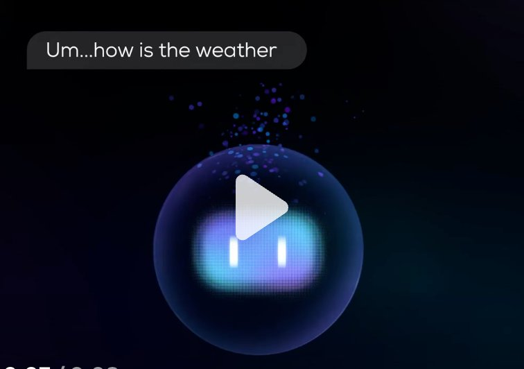
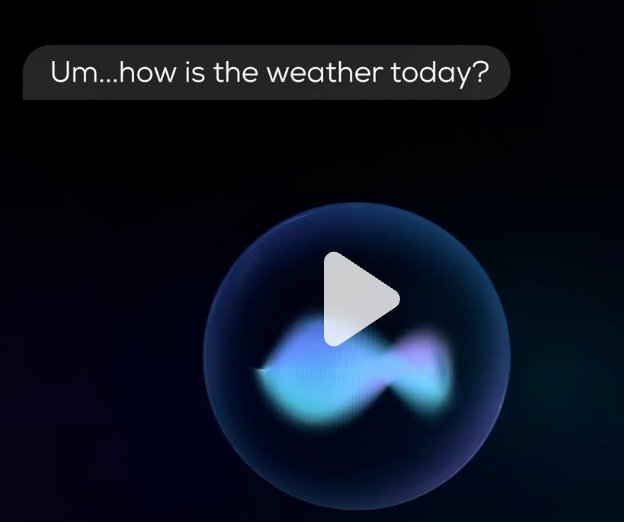

# AI Character Orb — Interactive Visualizer Component

> **A standalone, zero-dependency, reactive AI character visualizer inspired by next-gen futuristic AI interfaces.**  
> Designed and built for **SynthTone** by **Hari Aditya**. Licensed under MIT.




---

## 🌟 Features

1. **Reactive Mouse-Tracking Gaze (Image 1 reference):**
   - The inner digital screen and vertical slit eyes (`| |`) calculate 3D sphere parallax in real time to look at the user's cursor wherever it moves across the screen.
   - Natural organic blinking and micro-saccades.
2. **Fluid Soundwave Mode (Image 2 reference):**
   - Morphs seamlessly into a multi-layered, undulating chromatic soundwave (cyan, electric blue, and vivid magenta/purple) when speaking or generating speech.
3. **Web Audio API Reactivity:**
   - **Audio Playback Sync:** Attach to any HTML `<audio>` tag. The waveform oscillates to real voice frequencies and speech cadence.
   - **Microphone Input:** Activate live microphone mode so the orb reacts dynamically when the user speaks!
4. **Floating Cosmic Stardust Aura:**
   - Smooth canvas particle simulation wafting ethereal glowing dust above the orb.
5. **Zero Dependencies & Framework Agnostic:**
   - Pure modern ES6 JavaScript + CSS.
   - Works in **Vanilla HTML/JS**, **React**, **Next.js**, **Vue**, **Svelte**, and **Electron**.
   - Also available as a native Web Component (`<ai-character-orb>`).

---

## 🚀 Quick Start (HTML / Vanilla JS)

### 1. Include Files
Copy the `ai-character-orb/` folder into your project:

```html
<!-- Include stylesheet -->
<link rel="stylesheet" href="./ai-orb.css" />

<!-- Container where the orb lives -->
<div id="orb-container"></div>

<!-- Initialize script -->
<script type="module">
  import { AICharacterOrb } from "./ai-orb.js";

  const orb = new AICharacterOrb("#orb-container", {
    size: 260,                         // Diameter in pixels
    mode: "eyes",                      // 'eyes' | 'wave' | 'speaking' | 'listening'
    bubbleText: "Um...how is the weather", // Dialogue bubble text
    showBubble: true,
  });
</script>
```

### 2. Using the Native Web Component
Alternatively, import `ai-orb.js` and simply use the custom HTML tag:

```html
<link rel="stylesheet" href="./ai-orb.css" />
<script type="module" src="./ai-orb.js"></script>

<ai-character-orb size="260" mode="eyes" bubble="Hello world!"></ai-character-orb>
```

---

## 💻 Integration Examples

### React / Next.js

```jsx
import { useEffect, useRef } from 'react';
import './ai-orb.css';

export default function AIOrb({ mode = 'eyes', speechText = '' }) {
  const containerRef = useRef(null);
  const orbRef = useRef(null);

  useEffect(() => {
    let orb;
    import('./ai-orb.js').then(({ AICharacterOrb }) => {
      orb = new AICharacterOrb(containerRef.current, {
        size: 260,
        mode: mode,
        bubbleText: speechText,
      });
      orbRef.current = orb;
    });

    return () => {
      if (orbRef.current) orbRef.current.destroy();
    };
  }, []);

  useEffect(() => {
    if (orbRef.current) {
      orbRef.current.setMode(mode);
    }
  }, [mode]);

  return <div ref={containerRef} />;
}
```

---

## 🎛️ JavaScript API & Methods

| Method | Description |
| :--- | :--- |
| `orb.setMode('eyes' \| 'wave' \| 'speaking' \| 'listening')` | Switch between eye tracking mode and fluid waveform mode. |
| `orb.lookStraight(true \| false)` | Center gaze forward (useful when user is speaking or during announcements). |
| `orb.setBubble(text, durationMs)` | Update or hide the floating dialogue bubble above the orb. |
| `orb.triggerBlink()` | Manually trigger a quick eye blink animation. |
| `orb.attachAudio(audioElement)` | Connect an HTML `<audio>` tag to drive the wave with real frequency analysis. |
| `orb.listenMic()` | Request browser microphone to react to the user's real voice. |
| `orb.destroy()` | Clean up all event listeners, RAF loops, and audio contexts. |

---

## 🎨 CSS Customization

Customize colors and sizes via CSS variables on the container or `:root`:

```css
:root {
  --orb-size: 280px;            /* Orb diameter */
  --orb-cyan: #00f0ff;          /* Primary neon glow */
  --orb-magenta: #e040fb;       /* Secondary accent */
  --orb-blue: #3b82f6;          /* Deep aura */
  --orb-glow: rgba(0, 240, 255, 0.45);
}
```

---

## 📁 Folder Contents

- `ai-orb.js`: Core ES6 module and `<ai-character-orb>` custom element.
- `ai-orb.css`: High-performance CSS3 styling and animations.
- `index.html`: Interactive demo page to test mouse tracking, waves, and mic input.
- `reference-images/`: Original design references and UI inspirations.
- `README.md`: Integration guide.

---

## 📄 License

MIT License — Copyright (c) 2026 Hari Aditya. Free to use in personal, open-source, and commercial projects.
