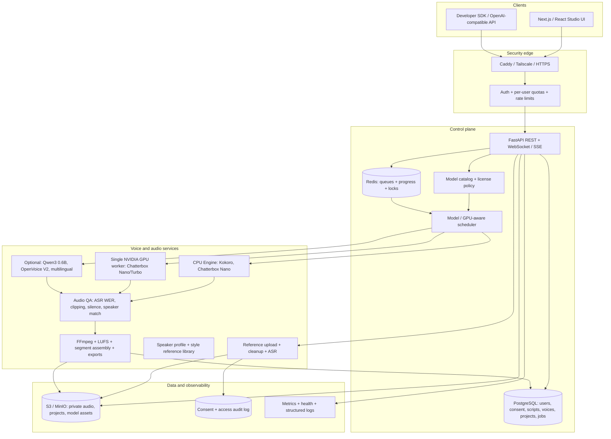

# SynthTone AI — Target Production Architecture v1.0

## 1. Design principles

1. Server-first: inference runs on Dell Linux; MacBook / iPhone are thin browser clients.
2. Model-agnostic: all engines implement one versioned adapter contract. One engine may run on CPU while GPU jobs are serialized.
3. Licensing-aware: weights are optional downloads, with license checks; no automatic redistribution.
4. Consent-bound voice identities: each reference voice is private and requires explicit speaker authorization, owner metadata, revocation and deletion.
5. Deterministic production pipeline around nondeterministic generators: retain text, model revision, seed (if supported), language, conditioning and post-processing metadata.
6. Smoothness is evaluated with measurable audio tests, not guaranteed by a UI slider.
7. Single Dell can generate sequentially; larger deployments add workers and GPUs without changing API contracts.

## 2. Full production system diagram



## 3. Service selection

| Layer | Alpha implementation | Production destination | Why |
|---|---|---|---|
| Frontend | Vanilla TypeScript-free JS/CSS in FastAPI static site | Next.js App Router + React + Tailwind + shadcn/ui + wavesurfer.js | Project/editor UX with waveform, keyboard controls and responsive shell |
| API | FastAPI | FastAPI + typed OpenAPI, Pydantic schemas | Easy multi-model inference integration |
| Queue | SQLite rows + a single worker thread | Redis / RQ or Celery; one GPU worker per 4 GB GPU | Crash recovery, cancellation, retries, separated failure domains |
| DB | SQLite WAL | PostgreSQL with Alembic migrations | Concurrent users and immutable audit entries |
| Audio/object storage | Private local folders | MinIO or S3-compatible object storage | Signed URLs, retention, isolation |
| GPU inference | PyTorch adapters on one process | Separate container per engine, lazy-loading / load shedding | Prevent CUDA environment/version conflicts |
| Reverse proxy | Loopback port / SSH tunnel | Tailscale Serve or Caddy with auth and TLS | Do not expose unauthenticated GPUs to the internet |
| Observability | Logs | OpenTelemetry + Prometheus/Grafana + redaction | Reproducible latency and error rates |

## 4. Proposed model contract

Each plugin implements:

```python
class TTSEngine(Protocol):
    def metadata(self) -> ModelMetadata: ...
    def load(self, device: str, precision: str) -> None: ...
    def supports(self, language: str, clone: bool, features: set[str]) -> bool: ...
    def synthesize(self, request: SynthesisChunk, reference: VoiceProfile | None) -> PCMChunk: ...
    def unload(self) -> None: ...
```

`ModelMetadata` includes model/checkpoint revision, license, voice-clone support, languages, reference-duration bounds, VRAM measured, RAM measured, output sample rate, speed-control support, streaming support, style controls and watermarking behavior. The router **must not** expose features the engine does not provide.

## 5. Smart model routing

1. Validate voice ownership and compatible language.
2. Normalize text conservatively and split into sentence/prosodic units.
3. If preset voice, choose Kokoro for fast low-memory results.
4. If authorized English voice clone, start Chatterbox Nano; offer Turbo for higher quality after a measured benchmark.
5. If multilingual, route to licensed enabled model supporting the exact language (Hindi via Chatterbox multilingual; do not claim Telugu without validation).
6. If Qwen3 0.6B experimental: queue separately, unload prior GPU model and measure peak VRAM. Reject rather than silently moving large tensors into RAM and crippling the server.
7. Generate one clip per segment; retain an immutable job manifest and validation report.
8. Run alignment/ASR/QA; selectively re-generate only failing segments (bounded retries).
9. Apply silence intervals, fades and loudness normalization, keep original lossless master and versioned export.
10. Deliver signed download links / authenticated streaming response.

For Dell 4 GB GPU: serialize GPU inference (`gpu_slots=1`) and keep one CUDA TTS checkpoint in memory. CPU jobs can use a limited independent lane. For performance-intensive workloads, CPU workers and GPU workers should be separate processes.

## 6. Persistent schema (target)

- `users(id, email, password_hash, role, created_at)`
- `projects(id, owner_id, title, created_at, updated_at)`
- `scripts(id, project_id, version, language, text, created_at)`
- `voices(id, owner_id, name, language, owner_attestation, active, created_at)`
- `reference_audio(id, voice_id, object_uri, sha256, duration_s, qa_score, transcript, created_at)`
- `voice_consents(id, voice_id, speaker_id, permission_basis, consent_timestamp, verification_method, revoked_at, evidence_uri)`
- `segments(id, script_id, idx, text, style_ref_id, pronunciation_map_id, boundary_ms)`
- `jobs(id, project_id, model_id, model_revision, reference_id, status, seed, progress, created_at, updated_at)`
- `artifacts(id, job_id, object_uri, format, duration_s, loudness_lufs, sample_rate, sha256)`
- `qa_reports(id, job_id, wer, speaker_similarity, clipping_ratio, silence_ratio, notes)`
- `audit_log(id, actor_id, action, resource_id, timestamp, metadata_redacted)`
- `api_tokens(id, user_id, hash, scope, expires_at, revoked_at)`

## 7. API target (versioned)

| Verb | Route | Meaning |
|---|---|---|
| POST | `/v1/voices` | Authorized voice upload with consent details |
| GET | `/v1/voices` | Voice library |
| DELETE | `/v1/voices/{id}` | Revoke and delete voice + associated embeddings per retention policy |
| POST | `/v1/speech/generations` | Generate one or many variants asynchronously |
| POST | `/v1/audio/speech` | OpenAI-compatible short TTS request, if enabled |
| GET | `/v1/jobs/{id}` | Status, progress, selected model/revision |
| POST | `/v1/jobs/{id}/cancel` | Cancel queued or cooperative in-flight job |
| GET | `/v1/jobs/{id}/events` | Progress via SSE |
| GET | `/v1/artifacts/{id}` | Authenticated download / signed URL |
| POST | `/v1/projects` | Create multi-segment studio project |
| PATCH | `/v1/projects/{id}/segments/{idx}` | Edit/regenerate a single segment |
| POST | `/v1/evaluate` | Compare samples in offline benchmarking mode |
| GET | `/v1/models` | Available models and compatibility |

API responses should use machine-readable failure types (`OUT_OF_MEMORY`, `UNSUPPORTED_LANGUAGE`, `VOICE_CONSENT_REQUIRED`, `MODEL_UNAVAILABLE`) and idempotency keys for job creation. Add API-key rotation, OAuth/SSO and least-privilege scopes before public deployment.

## 8. Distinctive intelligence — VoxTune Orchestrator

VoxTune **v0 is not a new trained acoustic foundation model**. It is an original, testable orchestration and quality-control subsystem:

- `Voice Identity Bank`: 2–5 owner-authorized style reference clips for one speaker (calm, energetic, tutorial), versioned and encrypted at rest.
- `Segment Prosody Planner`: produce target speaking rate, pauses, emotion labels (supported models only) and pronunciation per sentence.
- `Dynamic Route Selector`: choose best engine by language, memory budget, voice profile and measured speed/quality.
- `Consistency Gate`: compare speech recognition text and speaker embedding against references and adjacent segments.
- `Re-synthesis Controller`: attempt regeneration with controlled changes only on failed segments.
- `Mastering Engine`: silence/pause scheduling, declick, proper crossfade and LUFS normalization.
- `Experiment Registry`: track WER, speaker similarity, MOS ratings, RTF and GPU peak for every engine version.

A **genuinely new model** can be pursued later: a small, trainable prosody conditioning module or LoRA adapter for a selected upstream model, with speaker-consented data, baselines and ablations. Do not present a model router as a trained foundation model.

## 9. Security requirements

Details in `SECURITY.md`. AI voice cloning needs explicit consent verification; a self-declaration checkbox is **alpha-only**. Record revocations; avoid public voice catalogs by default; watermark generated audio where supported; rate-limit sensitive endpoints; defend against multipart and media decoder abuse; validate third-party model loading.
